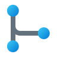

# Hi, I'm Anurag Gupta

### Software Engineer • DevOps • LFX Mentee @ GitMesh • AI & Cloud Infrastructure

  <picture>
    <source media="(prefers-color-scheme: dark)" srcset="card-dark.svg">
    
  </picture>

  
  
  
  
  
  

  

---

-  **LFX Mentee, The Linux Foundation** ([GitMesh](https://github.com/AnuragGupta181/gitmesh)): multi-agent AI infrastructure, MCP servers, TypeScript/Node.js microservices and GitHub Actions CI/CD. 15+ PRs, 30+ code reviews.
-  **MLOps Intern, Carbon Crunch**: fine-tuned Qwen2.5-VL-7B (-45% GPU memory) and built OCR pipelines that read 5,000+ PDFs and images.
-  **ML & DevOps Lead, Cloud Computing Cell (AKGEC)**: led 5 engineers on AWS ECS microservices (CQRS, ALB, MongoDB replica set, BullMQ + Redis) serving 250+ concurrent users for about $50. Deploys went from 45 min to under 5.
-  **Robotics**: 4-UAV swarm on ROS 2 Humble, PX4 and Gazebo; TurtleBot3 autonomous navigation; LabVIEW trainee at Tifac Lab.

---

##  Tech stack

<table>
  <tr>
    <td width="170"><b>Languages</b></td>
    <td>
      
      
      
      
      
      
      
      
    </td>
  </tr>
  <tr>
    <td width="170"><b>Frontend</b></td>
    <td>
      
      
      
      
      
      
    </td>
  </tr>
  <tr>
    <td width="170"><b>Backend</b></td>
    <td>
      
      
      
      
      
      
      
    </td>
  </tr>
  <tr>
    <td width="170"><b>Databases & Queues</b></td>
    <td>
      
      
      
      
      
    </td>
  </tr>
  <tr>
    <td width="170"><b>DevOps & Cloud</b></td>
    <td>
      
      
      
      
      
      
      
      
      
      
      
    </td>
  </tr>
  <tr>
    <td width="170"><b>Observability & Security</b></td>
    <td>
      
      
      
      
      
    </td>
  </tr>
  <tr>
    <td width="170"><b>AI / ML</b></td>
    <td>
      
      
      
      
      
      
      
      
      
      
    </td>
  </tr>
  <tr>
    <td width="170"><b>Robotics & Embedded</b></td>
    <td>
      
      
      
      
      
      
      
    </td>
  </tr>
  <tr>
    <td width="170"><b>Tools</b></td>
    <td>
      
      
      
      
      
      
    </td>
  </tr>
</table>

---

##  Projects

<table>
  <tr>
    <td width="50%" valign="top">
      <h3>FotoFix</h3>
      <b>AI image processing platform</b>
      
Full-stack site with <b>background removal</b>, <b>YOLO object detection</b> and OCR behind <b>10+ API endpoints</b>. Redis caching made repeat requests <b>60% faster</b> across 1,000+ uploads.

      
<b>Stack:</b> <code>React</code> <code>FastAPI</code> <code>YOLO</code> <code>OpenCV</code> <code>Redis</code> <code>AWS S3</code> <code>Docker</code>

      
 

    </td>
    <td width="50%" valign="top">
      <h3>Generative AI &amp; RAG Platform</h3>
      <b>Fact-grounded question answering</b>
      
Retrieves answers from JSON knowledge packs using <b>LangChain</b> and <b>LangGraph</b> agent workflows, traced with LangSmith. Raised site engagement by <b>30%</b>; FastAPI services on AWS absorbed an <b>80% traffic spike</b>.

      
<b>Stack:</b> <code>FastAPI</code> <code>LangChain</code> <code>LangGraph</code> <code>LangSmith</code> <code>AWS</code>

      

    </td>
  </tr>
  <tr>
    <td width="50%" valign="top">
      <h3>NextGen</h3>
      <b>Cloud assessment and contest platform</b>
      
Coding-contest platform for <b>250+ concurrent users</b> at about <b>$50</b> on AWS. ALB routes by path to <b>CQRS microservices</b> on ECS, with a MongoDB replica set (+40% throughput), Judge0, EC2 Auto Scaling, BullMQ + Redis, WAF and Cloudflare.

      
<b>Stack:</b> <code>AWS ECS</code> <code>MongoDB</code> <code>Redis</code> <code>BullMQ</code> <code>Judge0</code> <code>Nginx</code>

      
 

    </td>
    <td width="50%" valign="top">
      <h3>GitOps CI/CD Pipeline</h3>
      <b>Secure, zero-downtime delivery</b>
      
Jenkins Shared Library runs build, test, <b>SonarQube</b> gate and <b>Trivy</b> scan in <b>6 min 1 s</b>. Argo CD keeps 11 Kubernetes resources in sync; blue-green releases via Argo Rollouts served 231 requests with <b>0 server errors</b>.

      
<b>Stack:</b> <code>Jenkins</code> <code>Argo CD</code> <code>Argo Rollouts</code> <code>Trivy</code> <code>SonarQube</code> <code>Sealed Secrets</code>

      

    </td>
  </tr>
  <tr>
    <td width="50%" valign="top">
      <h3>Multi-UAV Swarm</h3>
      <b>Autonomous leader-follower drones</b>
      
<b>4 drones</b> fly in formation on ROS 2 Humble and PX4 with under <b>50 ms</b> data-sharing delay. They navigate without GPS using depth sensing, SLAM and A* path finding, with <b>95% path accuracy</b> in Gazebo.

      
<b>Stack:</b> <code>ROS 2</code> <code>PX4</code> <code>Gazebo SITL</code> <code>SLAM</code> <code>C++</code> <code>Python</code>

      

    </td>
    <td width="50%" valign="top">
      <h3>Multi-Modal OCR Pipeline</h3>
      <b>Document intelligence at scale</b>
      
Turns <b>5,000+ PDFs and images</b> into structured JSON at <b>86% accuracy</b>. Qwen2.5-VL-7B fine-tuned with Unsloth and LoRA (<b>-45% GPU memory</b>, 30% faster training); cloud cost down 35%.

      
<b>Stack:</b> <code>Python</code> <code>Qwen2.5-VL</code> <code>Unsloth</code> <code>LoRA</code> <code>Playwright</code> <code>FastAPI</code>

      

    </td>
  </tr>
  <tr>
    <td width="50%" valign="top">
      <h3>TurtleBot3 Navigation</h3>
      <b>Autonomous waypoint driving</b>
      
Drives through <b>5 waypoints at 100% success</b>, avoiding obstacles, with only 240 lines of custom code on Nav2. Traced a lost-localisation bug to a one-line fix in the Nav2 source.

      
<b>Stack:</b> <code>ROS 2</code> <code>Nav2</code> <code>AMCL</code> <code>DWB</code> <code>Gazebo</code>

      
 

    </td>
    <td width="50%" valign="top">
      <h3>Pesticide Detection Robot</h3>
      <b>Low-cost edge AI for farms</b>
      
ESP32-CAM robot that spots pests with <b>YOLOv12</b> in real time at <b>35% lower cost</b> than commercial options, driven by L298N motor drivers. Could cut manual field work by up to 80%.

      
<b>Stack:</b> <code>ESP32</code> <code>YOLOv12</code> <code>OpenCV</code> <code>MicroPython</code> <code>IoT</code>

      

    </td>
  </tr>
</table>

--- | :--- | :--- |
| **FotoFix**: AI image processing | React, FastAPI, YOLO, OpenCV, Redis, AWS S3 | [Code](https://github.com/AnuragGupta181/phot-fix-ml-fast) • [Live](https://image-processing-tool-c7k8.vercel.app) |
| **Generative AI & RAG platform** | FastAPI, LangChain, LangGraph, LangSmith, AWS | [Code](https://github.com/AnuragGupta181/ccc-ragbot) |
| **NextGen**: cloud contest platform | AWS ECS, MongoDB, Redis, BullMQ, Judge0 | [Code](https://github.com/AnuragGupta181/Coding-Plateform) • [Live](https://coding-plateform-egyb.vercel.app/) |
| **GitOps CI/CD pipeline** | Jenkins, Argo CD, Argo Rollouts, Trivy, SonarQube | [Code](https://github.com/AnuragGupta181/nextgen_cd) |
| **Multi-UAV swarm** | ROS 2 Humble, PX4, Gazebo SITL, SLAM | [Code](https://github.com/AnuragGupta181/drone-mine-detection) |
| **Multi-modal OCR pipeline** | Python, FastAPI, Qwen2.5-VL, LoRA, Playwright | [Code](https://github.com/AnuragGupta181/ocr) |
| **TurtleBot3 navigation** | ROS 2, Nav2, AMCL, DWB | [Code](https://github.com/AnuragGupta181/turtlebot) |
| **Pesticide detection robot** | ESP32-CAM, YOLOv12, OpenCV | [Code](https://github.com/AnuragGupta181/Pestiside-detection) |

---

##  Open source & honors

**25+ merged pull requests** across GitMesh, LabVIEW MCP and community projects ([all merged PRs](https://github.com/search?q=is%3Apr+is%3Amerged+author%3AAnuragGupta181&type=pullrequests)).

### Major contributions

**[GitMesh](https://github.com/LF-Decentralized-Trust-labs/gitmesh)** (The Linux Foundation, LFX mentee) — Policy-as-code engine for open-source AI agent orchestration

- Implemented Cursor and GitHub Copilot adapter detection for workspace adapters ([#458](https://github.com/LF-Decentralized-Trust-labs/gitmesh/pull/458), [#459](https://github.com/LF-Decentralized-Trust-labs/gitmesh/pull/459))
- Added the GitHub Actions CI workflow and improved UI route test coverage with a stable typecheck flow ([#403](https://github.com/LF-Decentralized-Trust-labs/gitmesh/pull/403), [#399](https://github.com/LF-Decentralized-Trust-labs/gitmesh/pull/399))
- Improved the Docker quickstart docs and troubleshooting ([#385](https://github.com/LF-Decentralized-Trust-labs/gitmesh/pull/385))
- Fixing inbound webhook routing in forge-sync ([#433](https://github.com/LF-Decentralized-Trust-labs/gitmesh/pull/433), open)
- Scoped roadmap work as issues: policy-as-code engine with OPA, tamper-evident audit log, maintainer dashboard, doctor risk-rule engine ([#435](https://github.com/LF-Decentralized-Trust-labs/gitmesh/issues/435), [#436](https://github.com/LF-Decentralized-Trust-labs/gitmesh/issues/436), [#437](https://github.com/LF-Decentralized-Trust-labs/gitmesh/issues/437), [#463](https://github.com/LF-Decentralized-Trust-labs/gitmesh/issues/463))

**[LabVIEW MCP](https://github.com/Zuehlke/labview-mcp)** (Zuehlke) — MCP server that connects AI agents to LabVIEW

- Found and fixed Error 1125 on LabVIEW 2019: the pylabview composer only restamped VI versions for 2020 and later ([#149](https://github.com/Zuehlke/labview-mcp/issues/149))
- Verified the fix on LabVIEW 2019 itself: plain VIs, subVI calls, case structures, loops and Formula Nodes load, run and save
- Fix merged upstream with my commit cherry-picked ([#150](https://github.com/Zuehlke/labview-mcp/pull/150))

**[Harbor Satellite](https://github.com/container-registry/harbor-satellite)** (CNCF) — Container registry for edge and disconnected sites

- Fixing broken Markdown links (404s) with a Hugo link render hook and adding a right-sidebar table of contents to the docs site ([#607](https://github.com/container-registry/harbor-satellite/pull/607), open)
- Reported missing unit tests for robot-secret refresh and scheduler shutdown races ([#626](https://github.com/container-registry/harbor-satellite/issues/626))

**Community projects** — [CityVoice](https://github.com/job4saurabh/CityVoice) (client dashboard and responsive UI), [Kryptonite](https://github.com/lovevarshney2007/Keryptonite) (AI chatbot API), [FotoFix](https://github.com/sarthakkaushik927/Image--Processing-Tool) (ML inference APIs), [NextGen](https://github.com/sarthakkaushik927/Coding-Plateform) (CI/CD to EC2)

### Honors

- 2nd place, Student Research Symposium (IEEE Xplore)
- Top 10 finalist, SyncUP Hackathon
- Top 20 of 300+ teams (top 7%), Smart India Hackathon internal round
- Certified LabVIEW Associate Developer (Core I and II), National Instruments

---

##  GitHub analytics

  
  

  

  

  

  
  

  
  

